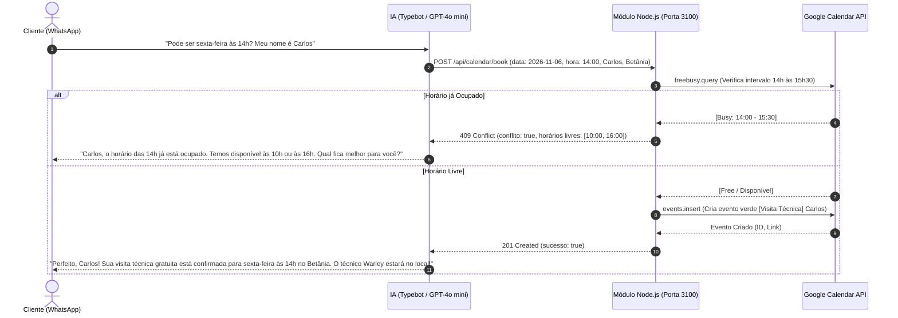

# Guia de Configuração: Integração Google Calendar (WarNat Tech)

Este guia orienta o passo a passo para conectar o Assistente Virtual (WhatsApp/Typebot) à sua **Google Agenda** pessoal ou corporativa. O sistema verifica horários ocupados em tempo real e impede qualquer agendamento duplicado.

---

## Como o Sistema Funciona



---

## Passo 1: Criar o Projeto e Ativar a API no Google Cloud (3 Minutos)

1. Acesse o console da Google Cloud:  
   👉 [https://console.cloud.google.com/](https://console.cloud.google.com/)
2. No topo da tela, clique no seletor de projetos e clique em **"Novo Projeto"**:
   - Nome do projeto: `Warnat-Tech-Agenda`
   - Clique em **Criar**.
3. No menu lateral ou na barra de busca superior, pesquise por:  
   👉 **`Google Calendar API`**
4. Clique sobre ela e clique no botão azul **"Ativar"** (Enable).

---

## Passo 2: Criar a Conta de Serviço (Service Account) e Baixar a Chave

1. No menu lateral esquerdo, vá em **APIs e Serviços** > **Credenciais**.
2. Clique no botão superior **"+ Criar Credenciais"** > selecione **"Conta de serviço"** (Service Account).
   - Nome da conta de serviço: `warnat-bot-calendar`
   - Descrição: `Agendador automatico de visitas tecnicas`
   - Clique em **"Criar e Continuar"** > depois em **"Concluir"**.
3. Na lista de "Contas de serviço", clique em cima do e-mail que acabou de ser criado (algo como `warnat-bot-calendar@warnat-tech-agenda.iam.gserviceaccount.com`).
4. **COPIE esse e-mail da conta de serviço**, você vai precisar dele no Passo 3!
5. Clique na aba superior **"Chaves"** (Keys):
   - Clique em **"Adicionar Chave"** > **"Criar nova chave"**.
   - Escolha o tipo **JSON** e clique em **Criar**.
   - O arquivo será baixado no seu computador!

---

## Passo 3: Salvar a Chave no Projeto

1. Renomeie o arquivo baixado para:  
   👉 `google-credentials.json`
2. Mova esse arquivo para a pasta do seu projeto:  
   👉 `D:\Projetos\evolution\google-credentials.json`
3. No arquivo `D:\Projetos\evolution\.env`, adicione a linha:
   ```env
   GOOGLE_CALENDAR_ID=seu-email-pessoal@gmail.com
   ```
   *(Substitua pelo e-mail da conta Google onde você quer ver os agendamentos no seu celular)*.

---

## Passo 4: Dar Permissão na sua Agenda do Google (Importante!)

Como a Service Account é um "robô", você precisa dar permissão para ela escrever na sua agenda:

1. Abra o [Google Agenda](https://calendar.google.com/) no seu navegador com o seu e-mail.
2. Na barra lateral esquerda, em **"Minhas agendas"**, passe o mouse sobre o seu nome/agenda, clique nos **três pontinhos** e vá em **"Configurações e compartilhamento"**.
3. Role até a seção **"Compartilhar com pessoas ou grupos específicos"**:
   - Clique em **"Adicionar pessoas e grupos"**.
   - Cole o e-mail da Service Account (aquele que termina com `...gserviceaccount.com`).
   - Em **Permissões**, selecione: 👉 **"Fazer alterações nos eventos"**.
   - Clique em **Enviar**.

---

## Pronto! Como Testar:

Abra o terminal e execute:
```powershell
node d:\Projetos\evolution\calendar\test-calendar.js
```
O script testará a comunicação e mostrará os horários livres e ocupados de hoje direto da sua agenda!
